# DESIGN.md — Sistem Desain Al-Futuuhat

| | |
|---|---|
| **Arah** | Tema gelap, editorial, "ruang baca yang tenang". Polanya terinspirasi tata letak baca Medium. |
| **Berlaku untuk** | Seluruh *frontend* Nuxt (`frontend/`) |
| **Berkas pendamping** | `frontend/assets/css/main.css` (token Tailwind v4 + komponen dasar), `docs/design/contoh-tampilan.html` (contoh yang bisa dibuka di peramban), `docs/design/*.png` (tangkapan layar contoh) |
| **Skill Claude Code** | `.claude/skills/desain-ui/SKILL.md` |
| **Pustaka komponen** | PrimeVue **4.5.5** (lisensi MIT), **hanya** untuk `OrganizationChart` (bagan struktur, §9) |
| **Status** | Draf 1.2 — 10 November 2026 (struktur organisasi berupa bagan PrimeVue OrganizationChart) |

> **Untuk Claude Code:** dokumen ini adalah sumber kebenaran untuk *tampilan*. *Apa* yang dibangun tetap mengikuti `docs/PRD.md`. Jangan menambah fitur karena "Medium punya fitur itu" (mis. *clap*, *bookmark*, *follow*, tag topik). Fitur tersebut tidak ada di PRD.

---

## 1. Prinsip

1. **Tulisan adalah produk.** Kolom baca sempit (680 px teks), huruf serif besar, dan banyak ruang kosong. Hiasan dibuat seminimal mungkin.
2. **Monokrom lebih dulu.** Hampir semua warna berasal dari skala abu-abu gelap. Ini sejalan dengan identitas Al-Futuuhat yang hitam-putih dan elegan.
3. **Aksen sand/gold dipakai hemat.** Aksen hanya untuk tautan, fokus *keyboard*, lencana notifikasi, dan ornamen kecil. Tidak boleh untuk blok besar atau tombol utama.
4. **Garis tipis, bukan bayangan.** Bagian-bagian dipisahkan oleh *hairline* 1 px (`garis`). Bayangan hanya untuk menu melayang dan modal.
5. **Serif untuk membaca, sans untuk antarmuka.** Judul dan isi materi memakai Source Serif 4. Navigasi, tombol, meta, dan formulir memakai Inter.
6. **Status selalu terlihat.** Karena materi bisa dibaca anggota sejak draf, setiap materi menampilkan *chip* status publikasi (lihat §7).

## 2. Pola dari Medium yang diambil

Nilai di kolom tengah berasal dari analisis pihak ketiga terhadap medium.com (lihat §13). Nilainya sedikit berbeda antarsumber, sehingga dipakai sebagai **acuan arah**, bukan angka mutlak.

| Pola | Pada Medium (menurut sumber) | Penerapan di Al-Futuuhat |
|---|---|---|
| Lebar kolom baca | ±680 px, sedangkan bingkai halaman ±1192 px | `max-w-baca` (728 px termasuk padding 24 px) dan `max-w-halaman` (1192 px) |
| Huruf isi bacaan | Serif (Charter / Source Serif), 20–21 px, *line-height* ±1,58–1,6 | Source Serif 4, 20 px / 1,6 (ponsel 18 px / 1,58) |
| Huruf antarmuka | Sans (Sohne, cadangan Helvetica/Inter), 13–16 px | Inter, 13–15 px |
| Judul artikel | Serif tebal ±42 px, *tracking* rapat | Source Serif 4 700, 42 px, `-0.022em` |
| Hero beranda | Serif raksasa dengan *leading* sangat rapat | Source Serif 4 600, 92 px / 0,95 |
| Header | Tinggi ±57 px, garis bawah tipis | 57 px, `border-b border-garis` |
| Daftar tulisan | Baris tanpa kartu, dipisah garis tipis, gambar kecil di kanan | Komponen `StoryRow` (§5) |
| Tombol | Bentuk pil penuh (*radius* 9999 px), tombol utama hitam | Pil; tombol primer **terang** karena latarnya gelap |
| Byline | Avatar bulat, nama, lalu meta "tanggal · menit baca" | Sama, ditambah *chip* status dan nomor versi |
| Tab | Teks dengan garis bawah tipis pada tab aktif | Komponen `Tabs` |
| Editor | Judul besar dan isi serif, *chrome* minimal | Quill tema *snow* yang dirapikan (§8) |

**Yang sengaja tidak diambil:** nama, logo, dan *wordmark* Medium; warna hijau merek Medium; ikon *clap*; bintang *member-only*; serta huruf komersial GT Super dan Sohne. Al-Futuuhat memakai *wordmark* teks sendiri dan huruf berlisensi terbuka (OFL).

## 3. Token

Semua token sudah ditulis di `frontend/assets/css/main.css` (blok `@theme`). **Di komponen, pakai kelas Tailwind dari token ini. Jangan menulis kode hex langsung.**

### 3.1 Warna

| Token | Hex | Kelas contoh | Peran |
|---|---|---|---|
| `kanvas` | `#121212` | `bg-kanvas` | Latar halaman |
| `permukaan` | `#1a1a1a` | `bg-permukaan` | Kotak cari, kartu statistik, sidebar admin, *composer* komentar |
| `angkat` | `#222222` | `bg-angkat` | Menu tarik-turun, modal, item menu aktif |
| `garis` | `#2a2a2a` | `border-garis` | Garis pemisah 1 px |
| `garis-kuat` | `#3d3d3d` | `border-garis-kuat` | Tepi tombol sekunder, *input*, *select* |
| `teks` | `#e6e6e6` | `text-teks` | Isi bacaan, teks umum |
| `teks-kuat` | `#f5f5f5` | `text-teks-kuat` | Judul, nama penulis, menu aktif |
| `teks-lembut` | `#a3a3a3` | `text-teks-lembut` | Ringkasan/dek, meta, menu tidak aktif |
| `teks-redup` | `#8a8a8a` | `text-teks-redup` | Keterangan gambar, *placeholder*, petunjuk |
| `aksen` | `#c9a96e` | `text-aksen` | Tautan, fokus, lencana notifikasi (hemat) |
| `tombol` / `tombol-teks` | `#f2f2f2` / `#121212` | `.btn-primer` | Tombol primer |
| `bahaya` | `#e07070` | `text-bahaya` | Hapus, pesan galat |
| `draf` / `diajukan` / `ditolak` / `terbit` | `#c7c7c7` / `#e0b25c` / `#e58a8a` / `#6fbf73` | `.chip-draf` dst. | Status publikasi (§7) |

**Kontras (WCAG):** semua warna teks di atas `kanvas` memiliki rasio ≥ 5,4 : 1, dan di atas `angkat` ≥ 4,6 : 1. Jadi seluruhnya lulus AA untuk teks normal. Rasionya dihitung dengan rumus *relative luminance* WCAG 2.x.

**Warna avatar inisial** (dipilih dari `user.id % 5`): `#c9a96e`, `#9fb4c7`, `#b7a3c9`, `#a9c49a`, `#d1a0a0`, dengan teks inisial `#121212`.

### 3.2 Tipografi

Paket: `npm i @fontsource-variable/source-serif-4 @fontsource-variable/inter`. Huruf dipaketkan bersama aplikasi, jadi tidak bergantung pada Google Fonts saat berjalan di Docker.

| Peran | Kelas | Huruf | Ukuran / *line-height* / berat |
|---|---|---|---|
| Hero beranda | `font-serif text-tampilan font-semibold` | Serif | 92 / 0,95 / 600 |
| Judul materi | `font-serif text-judul font-bold` (ponsel `text-judul-hp`) | Serif | 42 / 1,12 / 700 (ponsel 30) |
| Judul halaman admin | `font-serif text-halaman font-bold` | Serif | 32 / 1,2 / 700 |
| Subjudul dalam materi (H2) | `.prosa h2` | Serif | 26 / 1,25 / 700 |
| Judul di daftar (`StoryRow`) | `font-serif text-kartu font-bold` | Serif | 22 / 1,25 / 700 |
| Dek / ringkasan materi | `font-serif text-dek text-teks-lembut` | Serif | 22 / 1,4 / 400 |
| Isi materi | `.prosa` | Serif | 20 / 1,6 (ponsel 18 / 1,58) |
| Ringkasan di daftar | `text-base text-teks-lembut` | Sans | 16 / 1,5 |
| Navigasi, tombol | `text-sm` | Sans | 14 / 500 |
| Meta (tanggal, menit baca) | `text-[13px] text-teks-lembut` | Sans | 13 |
| Label tabel / grup menu | `text-xs uppercase tracking-wider text-teks-redup` | Sans | 12 |

*Wordmark* "Al-Futuuhat": `font-serif font-bold text-2xl tracking-tight text-teks-kuat`.

### 3.3 Spasi, radius, lebar

- **Spasi:** kelipatan 4 px dari skala Tailwind. Jarak antarbaris daftar `py-7` (28 px), jarak antarbagian halaman `py-11`–`py-16`.
- **Radius:** tombol, *chip*, kotak cari = `rounded-full`; kartu statistik dan *composer* = `rounded-lg` (8 px); gambar = `rounded-sm` (2–4 px). Jangan memakai radius besar pada kartu.
- **Lebar:** konten baca `max-w-baca mx-auto px-6`; halaman berkolom `max-w-halaman mx-auto px-6`; sidebar kanan 320 px; sidebar admin 248 px.
- **Breakpoint:** Tailwind bawaan. Sidebar kanan muncul mulai `lg` (1024 px), sedangkan sidebar admin berubah menjadi menu laci di bawah `lg`.

## 4. Tata letak (layout Nuxt)

| Layout | Header | Isi |
|---|---|---|
| `publik` | Kiri: *wordmark*. Kanan: Publikasi · Struktur · Cara bergabung · Masuk, lalu tombol pil **Daftar** (`btn-primer`). Tinggi 57 px, `border-b border-garis`. | Bebas, tanpa sidebar |
| `anggota` | Kiri: *wordmark* dan kotak cari pil (`bg-permukaan`, 240 px). Kanan: Arsip · Materi saya · Struktur, lalu "Tulis" (ikon pena), lonceng notifikasi dengan lencana `bg-aksen`, dan avatar (menu: Dasbor, Notifikasi, Keluar; admin juga mendapat "Panel admin"). | Dua kolom (konten + sidebar 320 px, dipisah `border-l border-garis`) untuk daftar; satu kolom `max-w-baca` untuk baca/tulis |
| `admin` | Tanpa header atas. Sidebar kiri `bg-permukaan` berisi *wordmark*, grup menu (Ringkasan, Keanggotaan, Materi, Akun/Keluar), dan lencana jumlah antrean `bg-aksen`. | `px-12 py-9`, judul halaman serif 32 px |

Menu aktif: `text-teks-kuat`. Menu tidak aktif: `text-teks-lembut`, dengan *hover* `text-teks-kuat`.

## 5. Komponen

Nama komponen disarankan untuk `frontend/components/`. Kelas `.btn*`, `.chip*`, `.input`, dan `.prosa` sudah ada di `main.css`.

| Komponen | Anatomi & aturan |
|---|---|
| `BaseButton` | `variant`: `primer` (pil terang), `sekunder` (pil bergaris), `hantu` (tanpa latar), `bahaya`. `size`: `sm` 32 px, `md` 36 px, `lg` 44 px. Dalam satu kelompok hanya boleh ada **satu** tombol primer. |
| `StatusChip` | Prop `status` (`draf`/`diajukan`/`ditolak`/`terbit`), dipetakan sesuai §7. Opsional `versi` → "Draf · v1". |
| `AvatarInisial` | Bulat; 20 / 32 / 44 px; dua huruf inisial dan warna dari `id % 5`. **Foto pendaftar tidak dipakai sebagai avatar** (KNF-02). |
| `SearchPill` | Tinggi 40 px, `rounded-full bg-permukaan`, ikon kaca pembesar 16 px, *placeholder* `text-teks-redup`. |
| `Tabs` | Teks 14 px; tab aktif `text-teks-kuat` dengan garis bawah 1 px `border-teks-kuat`; garis dasar `border-b border-garis`; angka jumlah `text-teks-redup` (opsional). |
| `StoryRow` | Baris `grid grid-cols-[1fr_160px] gap-12 py-7 border-b border-garis`. Isinya: (1) avatar 20 px, nama penulis, dan `StatusChip` (hanya di area anggota); (2) judul serif 22 px; (3) ringkasan sans 16 px `text-teks-lembut`, maksimal 3 baris (`line-clamp-3`); (4) meta: tanggal · menit baca · ikon komentar + jumlah. Gambar 160×107 px `rounded` di kanan **hanya jika ada** (lihat §10). Tanpa kartu, tanpa bayangan. |
| `ArticleHeader` | Judul 42 px, dek 22 px, byline (avatar 44 px, nama, dan meta "Diperbarui … · n menit baca · vN"), lalu `StatusChip` rata kanan (khusus area anggota). |
| `ActionBar` | Baris di antara `border-y border-garis`, tinggi ±48 px: "n komentar" (menggulir ke forum), "Riwayat versi" (membuka panel), dan catatan kanan `text-[13px] text-teks-redup` seperti "Anda membaca v3 (draf revisi) · Versi publik: v2" (KP-16.4). |
| `RiwayatVersi` | Panel/laci kanan berisi daftar versi: nomor, `StatusChip`, tanggal, catatan revisi. Catatan keputusan admin **hanya** dirender jika API mengirimkannya (penulis & admin, KP-13.2/13.3). |
| `ForumDiskusi` | Judul "Diskusi (n)" sans 20 px, indikator **Langsung** (titik hijau `terbit` saat Echo tersambung; abu-abu "Terputus" saat tidak). |
| `KomentarComposer` | Kotak `bg-permukaan rounded-lg ring-1 ring-garis p-4`: avatar dan *textarea* tanpa tepi, tombol ikon gambar dengan petunjuk "JPG/PNG maks. 2 MB", tombol `btn-primer btn-sm` "Kirim". |
| `KomentarItem` | Kepala: avatar 32 px, nama `text-teks-kuat`, waktu relatif `text-teks-redup`, dan label "Penulis" bila komentator adalah penulis materi. Isi sans 15 / 1,6, menjorok 42 px. Aksi teks 13 px: Balas, Hapus (Hapus hanya untuk pemilik). Balasan menjorok dengan `border-l-2 border-garis`. Komentar yang baru masuk lewat Reverb diberi latar `bg-aksen/10` yang memudar dalam 2 detik. |
| `StatCard` | `bg-permukaan rounded-lg ring-1 ring-garis px-5 py-4`; label 13 px `text-teks-lembut`; angka serif 34 px. |
| `DataTable` (admin) | Kepala kolom 12 px huruf kapital `text-teks-redup`; baris `py-4 border-b border-garis`; judul materi serif 17 px semibold dengan subteks 13 px. |
| `Pagination` | Angka dalam lingkaran 36 px; halaman aktif `bg-permukaan text-teks-kuat`. |
| `EmptyState` | Teks serif 22 px `text-teks-lembut` di tengah, satu kalimat ajakan, dan maksimal satu tombol. Contoh: "Materi tidak ditemukan." (KP-16.3). |
| `Toast` | Pojok kanan bawah, `bg-angkat rounded-lg`, bayangan, hilang setelah 4 detik. Contoh: "Materi disimpan.", "Pengajuan dibatalkan." |
| `BaganStruktur` | Membungkus PrimeVue `OrganizationChart` di dalam `.bagan-wrap > .bagan-scroll`. Akar = kotak **Pengurus inti**; cabang = satu kotak per **divisi** (nama serif, jumlah orang, koordinator); daun = satu kotak **daftar anggota divisi**. Divisi dapat dibuka-tutup; semua tertutup saat pertama tampil. Rincian di §9. |
| `ConfirmDialog` | Modal `bg-angkat rounded-xl p-6 max-w-md`; judul sans 18 px; tombol kanan: `btn-hantu` "Batal" dan `btn-primer` atau `btn-bahaya`. Dipakai untuk Hapus materi, Ajukan publikasi, Batalkan pengajuan, dan Tolak (dengan isian catatan wajib). |

Ikon: gaya garis (*outline*), *stroke* 1,5, sudut membulat, ukuran 16/20 px. Disarankan `lucide-vue-next`.

## 6. Pola halaman (dengan contoh)

Ada 31 layar contoh yang mencakup semua route di PRD §12 beserta keadaan pentingnya. Buka `docs/design/contoh-tampilan.html` di peramban (ada daftar isi yang bisa diklik). Semua contoh memakai data fiktif.

### 6.0 Indeks

| No | Area | Halaman | Route | Gambar |
|---|---|---|---|---|
| 01 | Publik | Beranda | `/` | `design/01-beranda.png` |
| 02 | Publik | Daftar publikasi | `/publikasi` | `design/02-publikasi.png` |
| 03 | Publik | Baca publikasi | `/publikasi/[slug]` | `design/03-publikasi-baca.png` |
| 04 | Publik | Formulir pendaftaran | `/daftar` | `design/04-daftar.png` |
| 05 | Publik | Pendaftaran terkirim | `/daftar/berhasil` | `design/05-daftar-berhasil.png` |
| 06 | Publik | Masuk | `/masuk` | `design/06-masuk.png` |
| 07 | Anggota | Dasbor anggota | `/dasbor` | `design/07-dasbor.png` |
| 08 | Anggota | Arsip materi anggota | `/materi` | `design/08-arsip.png` |
| 09 | Anggota | Baca materi + forum | `/materi/[slug]` | `design/09-baca.png` |
| 10 | Anggota | Panel riwayat versi | `/materi/[slug] → Riwayat versi` | `design/10-riwayat.png` |
| 11 | Anggota | Materi saya | `/materi-saya` | `design/11-materi-saya.png` |
| 12 | Anggota | Tulis materi baru | `/materi-saya/baru` | `design/12-editor-baru.png` |
| 13 | Anggota | Ubah materi (draf) | `/materi-saya/[id]/edit` | `design/13-editor.png` |
| 14 | Anggota | Editor saat diajukan (terkunci) | `/materi-saya/[id]/edit` | `design/14-editor-diajukan.png` |
| 15 | Anggota | Struktur organisasi (bagan) | `/struktur` | `design/15-struktur.png` |
| 16 | Anggota | Notifikasi | `/notifikasi` | `design/16-notifikasi.png` |
| 17 | Admin | Dasbor admin | `/admin` | `design/17-admin-dasbor.png` |
| 18 | Admin | Daftar pendaftar | `/admin/pendaftaran` | `design/18-admin-pendaftaran.png` |
| 19 | Admin | Detail pendaftar | `/admin/pendaftaran/[id]` | `design/19-admin-pendaftaran-detail.png` |
| 20 | Admin | Data anggota | `/admin/anggota` | `design/20-admin-anggota.png` |
| 21 | Admin | Detail & ubah anggota | `/admin/anggota/[id]` | `design/21-admin-anggota-detail.png` |
| 22 | Admin | Kelola struktur (tab Pengurus) | `/admin/struktur` | `design/22-admin-struktur.png` |
| 23 | Admin | Antrean verifikasi publikasi | `/admin/verifikasi-materi` | `design/23-admin-verifikasi.png` |
| 24 | Admin | Tinjau revisi (bandingkan versi) | `/admin/verifikasi-materi/[revisiId]` | `design/24-admin-tinjau.png` |
| 25 | Admin | Dialog tolak (catatan wajib) | `/admin/verifikasi-materi/[revisiId] → Tolak` | `design/25-admin-tolak.png` |
| 26 | Lainnya | Keadaan memuat & kosong | `(semua halaman daftar)` | `design/26-keadaan.png` |
| 27 | Lainnya | Halaman tidak ditemukan (404) | `(route tidak ada / materi belum terbit)` | `design/27-404.png` |
| 28 | Lainnya | Baca materi di ponsel | `/materi/[slug] (390 px)` | `design/28-mobile.png` |
| 29 | Lainnya | Daftar publikasi di ponsel | `/publikasi (390 px)` | `design/29-mobile-publikasi.png` |
| 30 | Lainnya | Menu laci di ponsel | `(layout anggota, 390 px)` | `design/30-mobile-menu.png` |
| 31 | Lainnya | Bagan struktur di ponsel | `/struktur (390 px)` | `design/31-mobile-struktur.png` |

### 6.1 Publik

#### 01 · Beranda — `/`
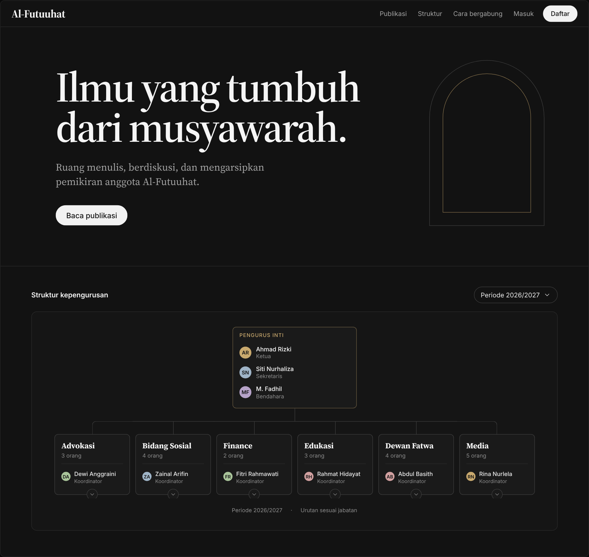
- **Hero:** judul serif 92 px rata kiri, 2 baris, maksimal ±700 px; dek serif 22 px `text-teks-lembut`; satu tombol `btn-primer btn-lg` "Baca publikasi". Ornamen lengkung hanya dekorasi dan disembunyikan di bawah `lg`.
- **Struktur:** pemilih periode berbentuk pil, lalu `BaganStruktur` dengan semua divisi tertutup (tanpa tombol "Buka/Tutup semua"). Hanya nama dan jabatan (KP-01.5).

#### 02 · Daftar publikasi — `/publikasi`
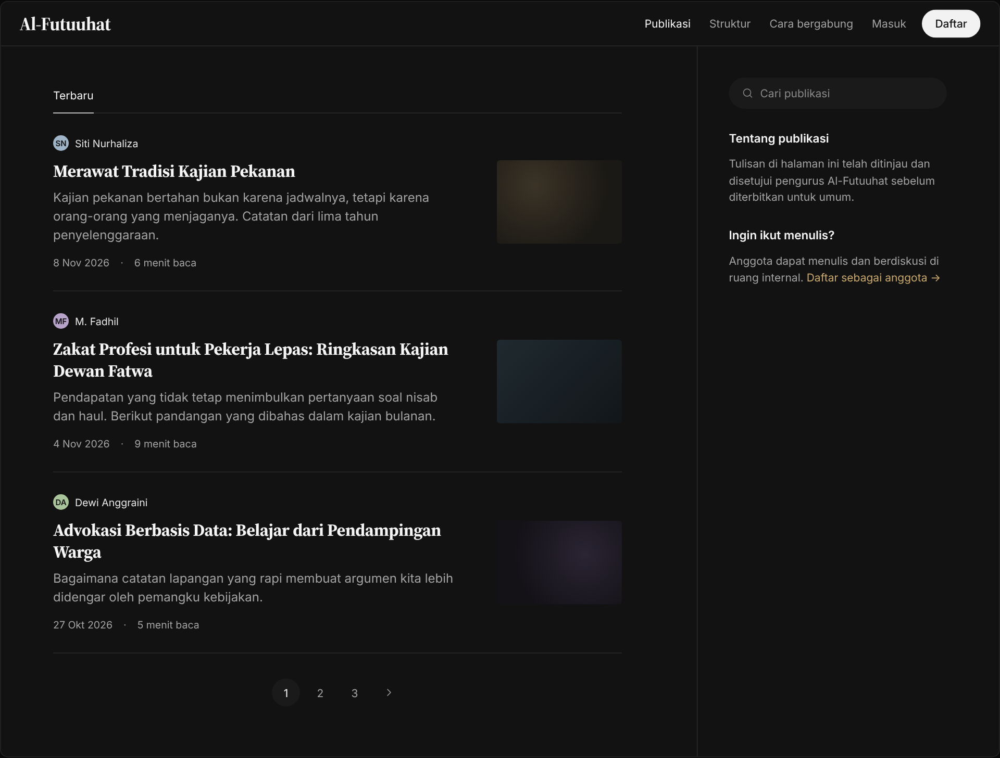
- Daftar `StoryRow` **tanpa** `StatusChip` (semuanya sudah terbit). Sidebar: kotak cari, "Tentang publikasi", ajakan mendaftar (tautan `text-aksen`).

#### 03 · Baca publikasi — `/publikasi/[slug]`
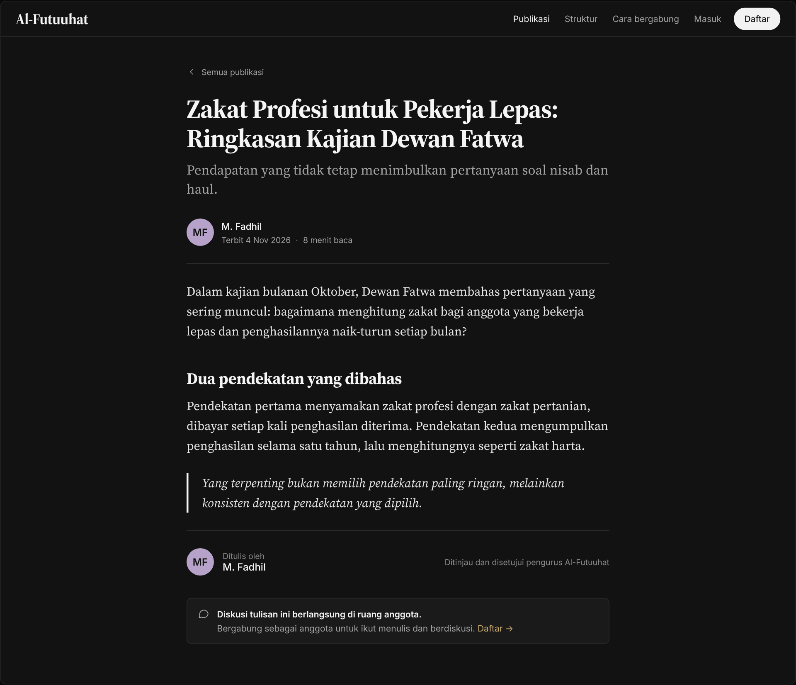
- Pola baca materi **tanpa** `ActionBar`, riwayat versi, dan forum (KP-17.4); hanya versi publik (KP-17.2).
- Di bawah isi: nama penulis, keterangan "Ditinjau dan disetujui pengurus", lalu kotak ajakan bergabung sebagai pengganti forum.

#### 04 · Formulir pendaftaran — `/daftar`
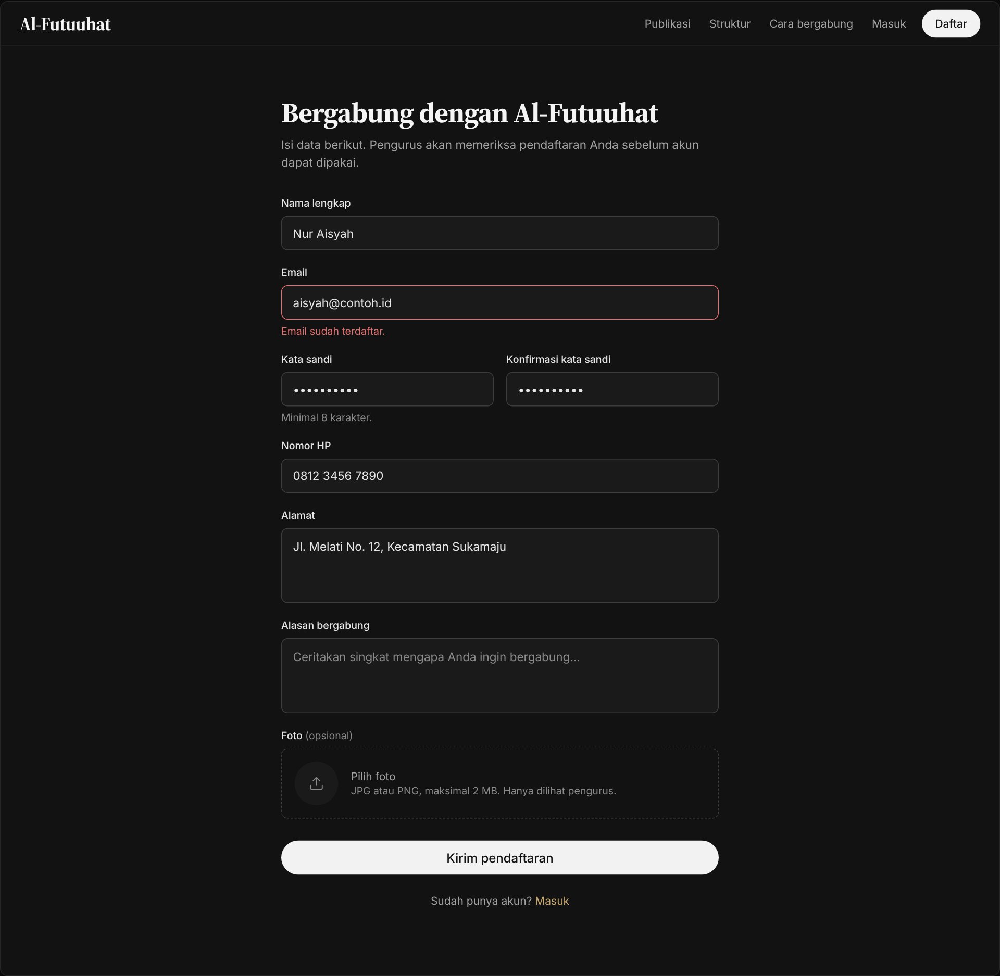
- Satu kolom selebar 560 px. Pesan galat di bawah isian, isian lain tidak hilang (KP-02.2, 02.5).
- Foto opsional dengan petunjuk "JPG atau PNG, maksimal 2 MB. Hanya dilihat pengurus." Tombol kirim selebar formulir.

#### 05 · Pendaftaran terkirim — `/daftar/berhasil`
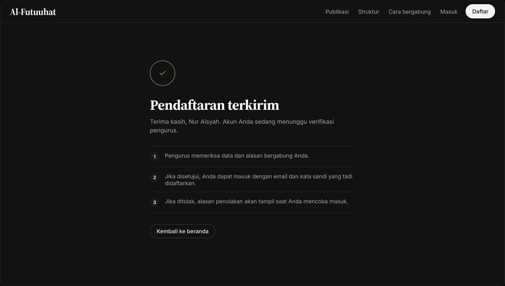
- Tanda centang bergaris aksen, judul serif, lalu tiga langkah berikutnya. Tidak ada login otomatis (KP-03.2).

#### 06 · Masuk — `/masuk`
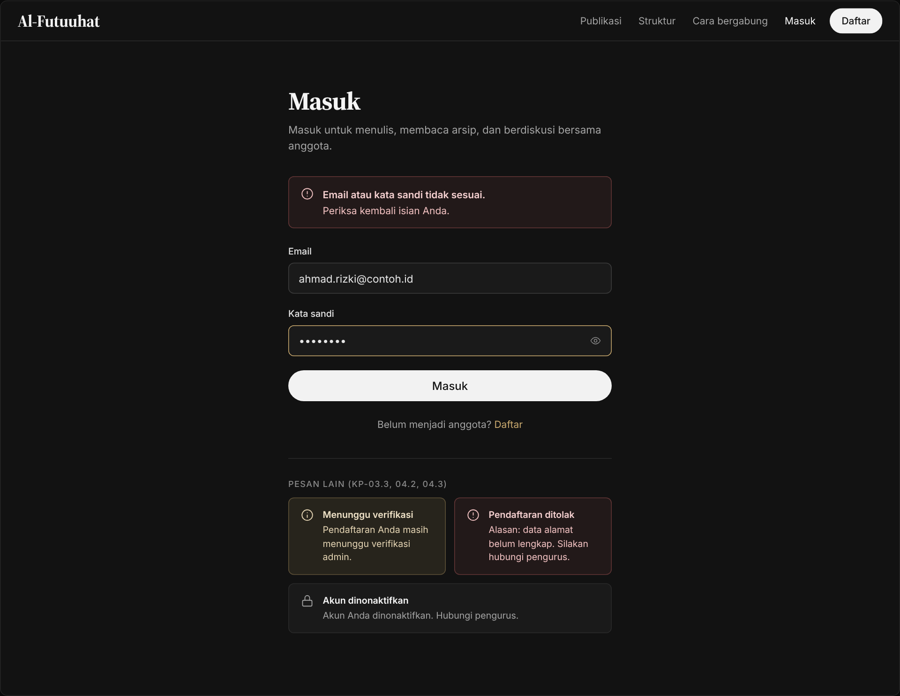
- Satu `alert` di atas formulir sesuai respons API: salah kredensial, menunggu, ditolak (beserta alasan admin), atau nonaktif (KP-03.3, 04.1–04.3). Bagian "Pesan lain" di contoh hanya peraga, tidak ikut dibangun.

### 6.2 Anggota

#### 07 · Dasbor anggota — `/dasbor`
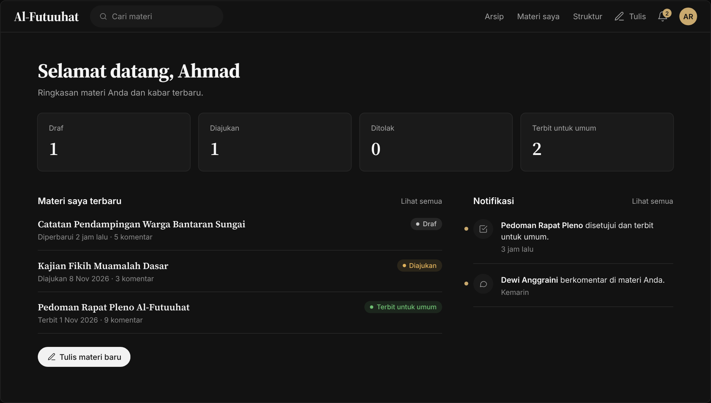
- 4 `StatCard` = jumlah materi milik sendiri per status publikasi; panel "Materi saya terbaru" dan "Notifikasi"; tombol "Tulis materi baru".

#### 08 · Arsip materi anggota — `/materi`
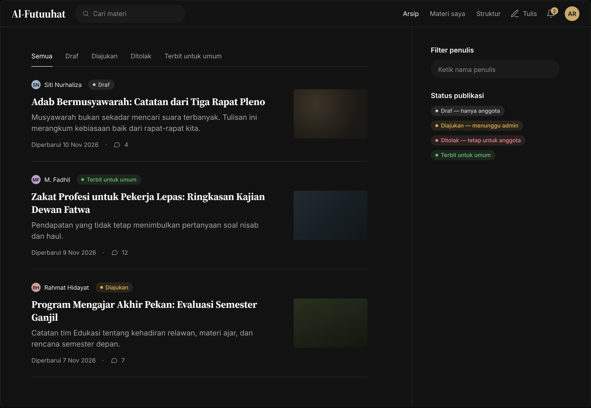
- `Tabs` status: Semua · Draf · Diajukan · Ditolak · Terbit untuk umum. `StoryRow` **dengan** `StatusChip`. Sidebar berisi filter penulis dan legenda status (KF-16).

#### 09 · Baca materi + forum — `/materi/[slug]`
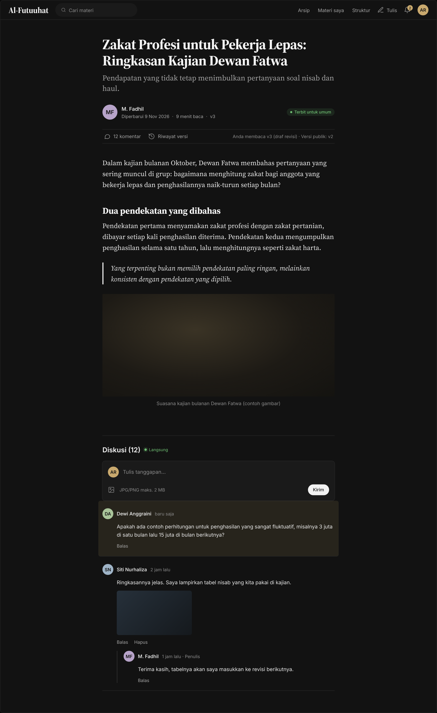
- Urutan: `ArticleHeader` → `ActionBar` → `.prosa` (isi revisi terakhir) → `ForumDiskusi`. Catatan kanan `ActionBar`: "Anda membaca v3 (draf revisi) · Versi publik: v2" (KP-16.4).
- Komentar baru dari Reverb diberi latar aksen tipis yang memudar; label "Penulis" pada balasan penulis materi.

#### 10 · Panel riwayat versi — `/materi/[slug] → Riwayat versi`
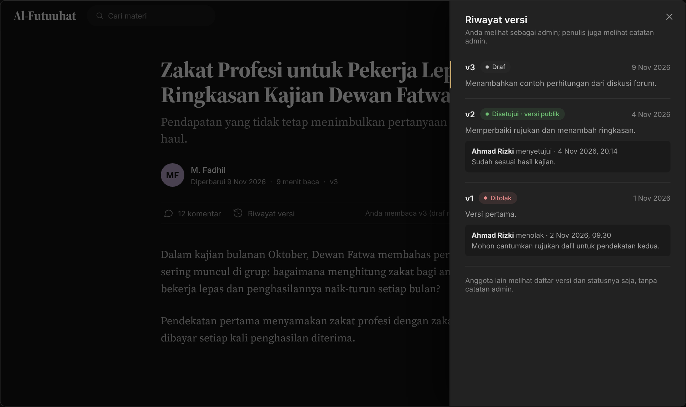
- Laci kanan 440 px di atas lapisan gelap. Versi yang sedang dibaca ditandai garis aksen di kiri.
- Kotak catatan keputusan admin **hanya** dirender untuk penulis dan admin; anggota lain hanya melihat nomor, status, tanggal, dan catatan revisi (KP-13.2, 13.3).

#### 11 · Materi saya — `/materi-saya`
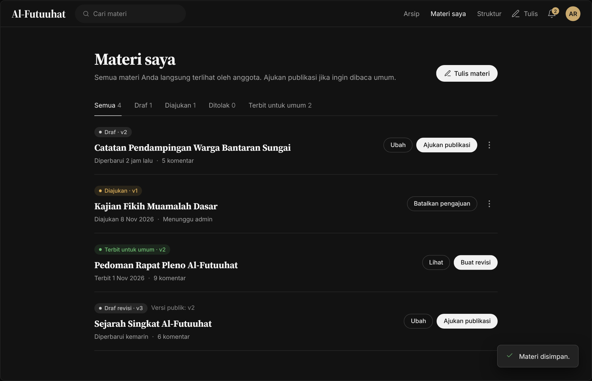
- `Tabs` dengan jumlah per status. Tombol per baris mengikuti §7: Ubah + Ajukan publikasi (draf), Batalkan pengajuan (diajukan), Lihat + Buat revisi (terbit). Menu titik tiga untuk Hapus (hanya materi yang belum pernah terbit).
- Materi terbit yang punya revisi draf menampilkan *chip* "Draf revisi · v3" dan keterangan "Versi publik: v2". *Toast* di pojok kanan bawah.

#### 12 · Tulis materi baru — `/materi-saya/baru`
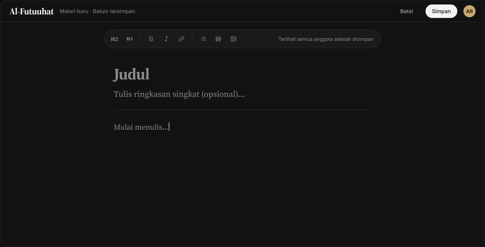
- *Placeholder* judul, ringkasan, dan isi. Header hanya "Batal" (hantu) dan "Simpan" (primer); "Ajukan publikasi" baru muncul setelah materi tersimpan.

#### 13 · Ubah materi (draf) — `/materi-saya/[id]/edit`
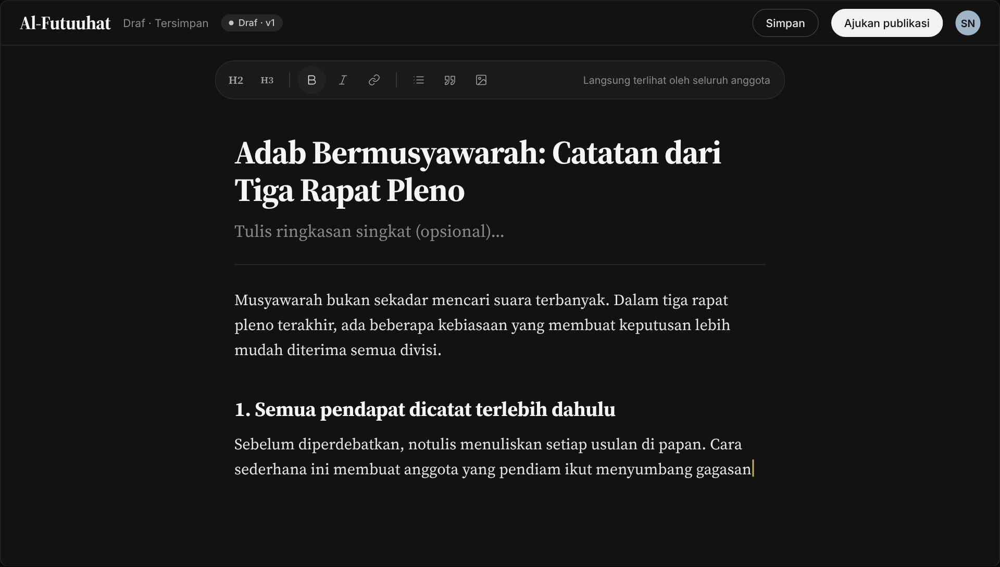
- Header: status simpan, `StatusChip` + versi, "Simpan" (sekunder), "Ajukan publikasi" (primer). Toolbar pil menempel, judul 42 px, ringkasan 22 px, isi Quill.
- Petunjuk "Langsung terlihat oleh seluruh anggota" (KP-08.5). Jika materi pernah terbit, judul dan ringkasan dikunci (KP-12.4).

#### 14 · Editor saat diajukan (terkunci) — `/materi-saya/[id]/edit`
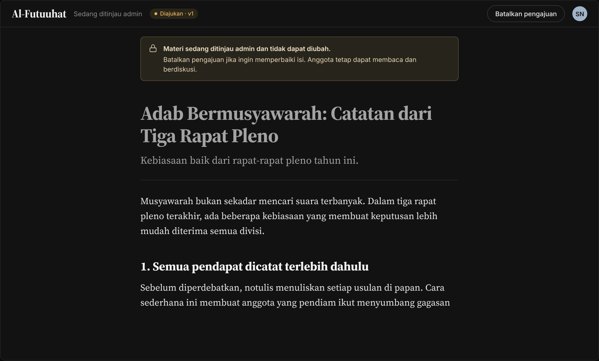
- Toolbar diganti `alert` aksen "Materi sedang ditinjau admin dan tidak dapat diubah"; isi tampil hanya-baca. Satu tombol "Batalkan pengajuan" (KP-10.4, 10.6).

#### 15 · Struktur organisasi (bagan) — `/struktur`
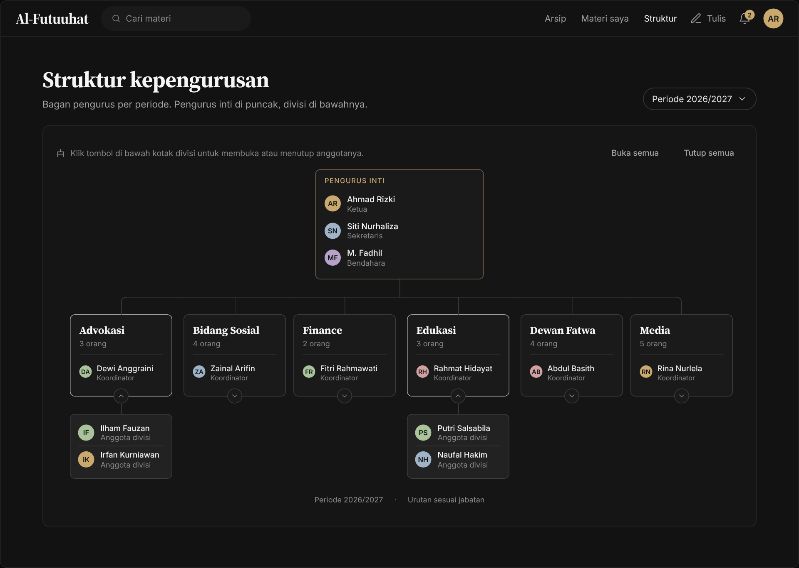
- `BaganStruktur` lengkap dengan petunjuk dan tombol "Buka semua"/"Tutup semua". Contoh memperlihatkan Advokasi dan Edukasi terbuka.
- Kotak Pengurus inti bergaris aksen; garis penghubung `garis-kuat` bersudut membulat; tombol buka-tutup bulat di tepi bawah kotak divisi.

#### 16 · Notifikasi — `/notifikasi`
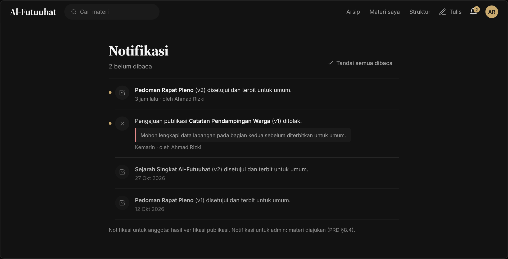
- Titik aksen di kiri untuk yang belum dibaca; yang sudah dibaca diredupkan. Notifikasi penolakan memuat catatan admin (hanya diterima penulis). Tombol "Tandai semua dibaca".

### 6.3 Admin

#### 17 · Dasbor admin — `/admin`
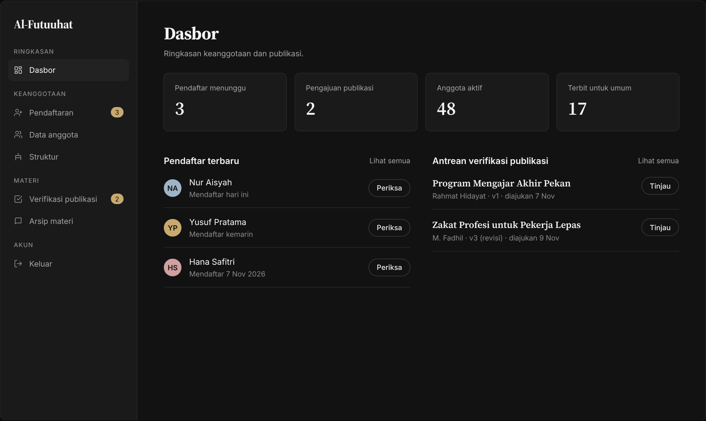
- 4 `StatCard` (KP dasbor admin), lalu dua panel: pendaftar terbaru dan antrean verifikasi publikasi, masing-masing dengan tombol menuju halaman detail.

#### 18 · Daftar pendaftar — `/admin/pendaftaran`
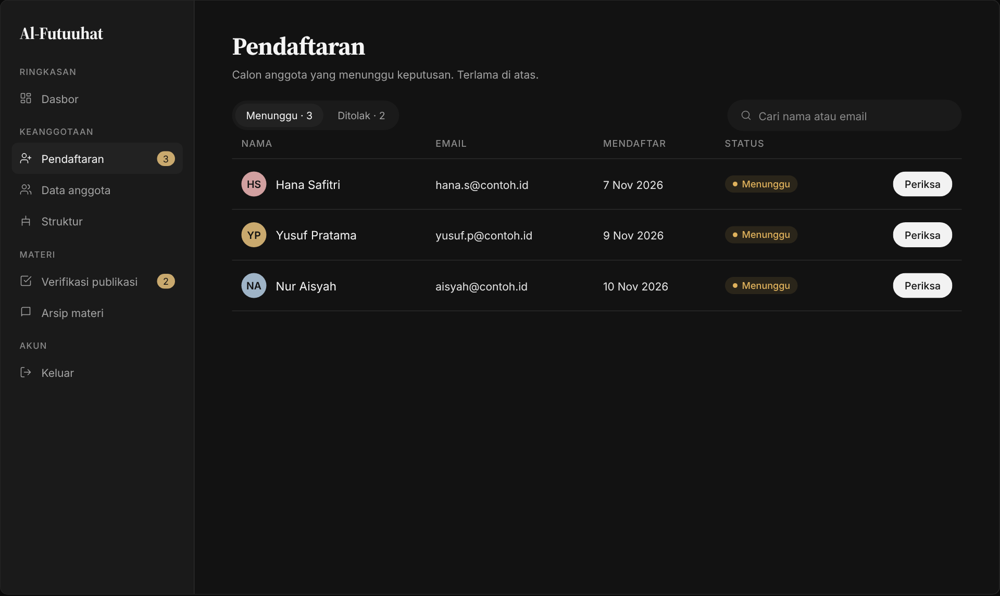
- Filter segmen Menunggu/Ditolak, kotak cari, `DataTable` terlama di atas (KP-05.1).

#### 19 · Detail pendaftar — `/admin/pendaftaran/[id]`
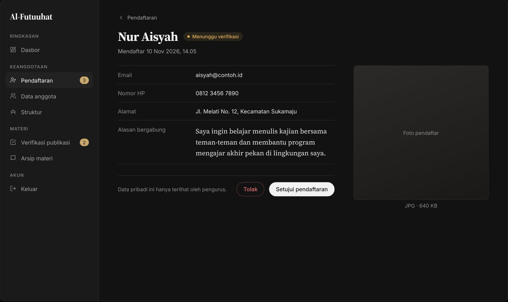
- Daftar data (email, HP, alamat, alasan bergabung dalam serif) di kiri, foto di kanan (KP-05.2). Bilah keputusan di bawah: Tolak (membuka dialog catatan wajib seperti layar 25) dan Setujui.

#### 20 · Data anggota — `/admin/anggota`
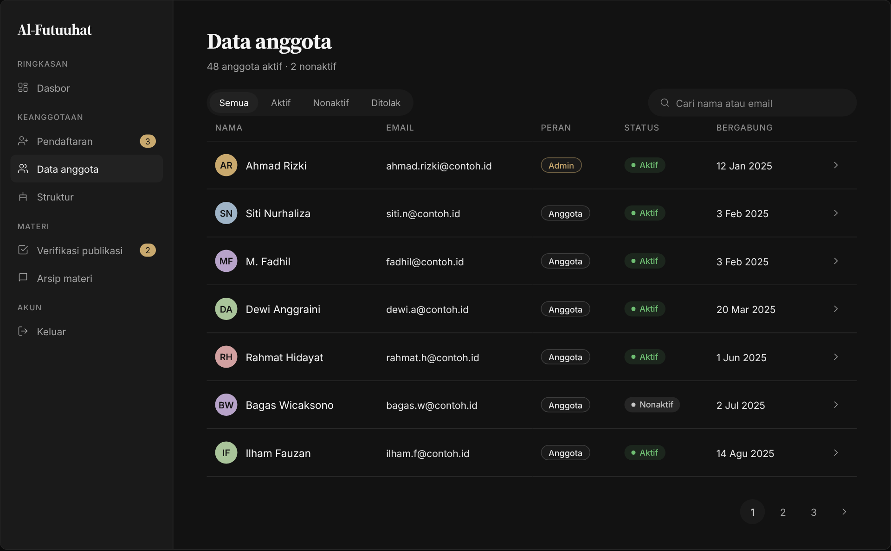
- Filter segmen status, kotak cari, tabel berpaginasi; *badge* peran Admin bergaris aksen (KP-06.1).

#### 21 · Detail & ubah anggota — `/admin/anggota/[id]`
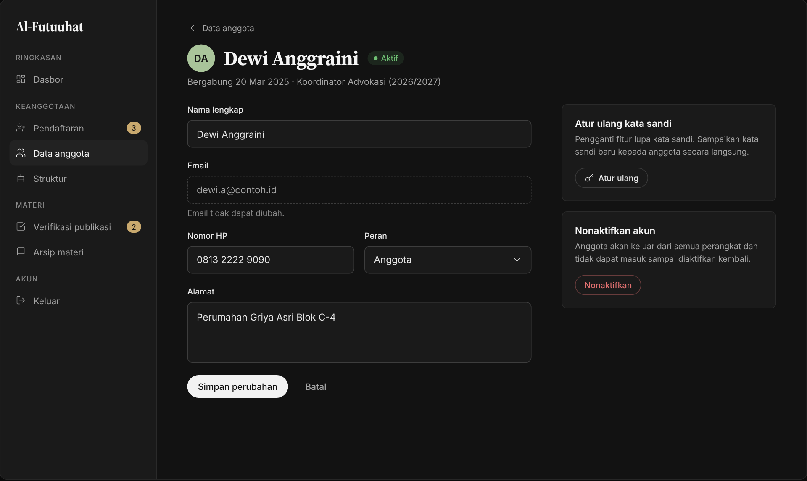
- Formulir ubah data dan peran; email terkunci. Aksi berisiko dipisah ke kartu kanan: atur ulang kata sandi dan nonaktifkan (KP-06.2–06.4). Pada akun sendiri, tombol nonaktifkan dan pilihan turun peran disembunyikan (KP-06.5).

#### 22 · Kelola struktur (tab Pengurus) — `/admin/struktur`
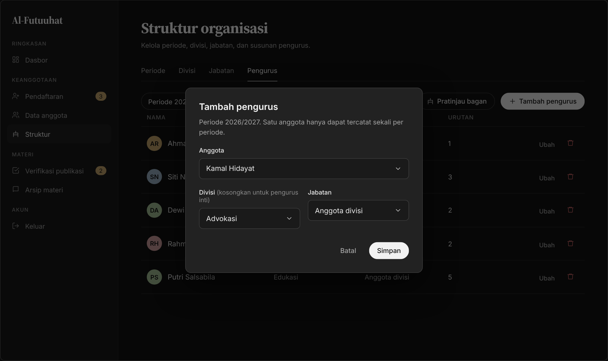
- `Tabs` Periode · Divisi · Jabatan · Pengurus. Tab Pengurus: pemilih periode, tabel, tombol "Pratinjau bagan" (membuka `BaganStruktur` periode itu dalam modal lebar atau tab baru ke `/struktur`), dan modal "Tambah pengurus". Pengelolaan tetap lewat tabel; bagan hanya untuk tampilan. Galat 422 (anggota ganda, data masih dipakai) tampil di modal sebagai `pesan-galat` (KP-07.4, 07.5).

#### 23 · Antrean verifikasi publikasi — `/admin/verifikasi-materi`
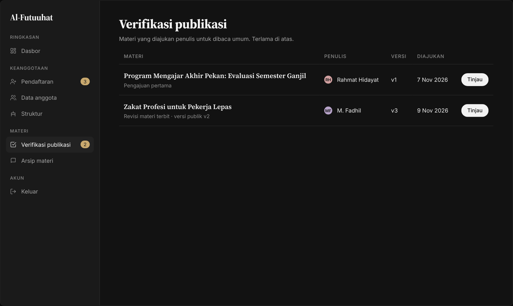
- `DataTable` antrean, terlama di atas, dengan subteks "Pengajuan pertama" atau "Revisi materi terbit · versi publik vN" (KP-11.1).

#### 24 · Tinjau revisi (bandingkan versi) — `/admin/verifikasi-materi/[revisiId]`
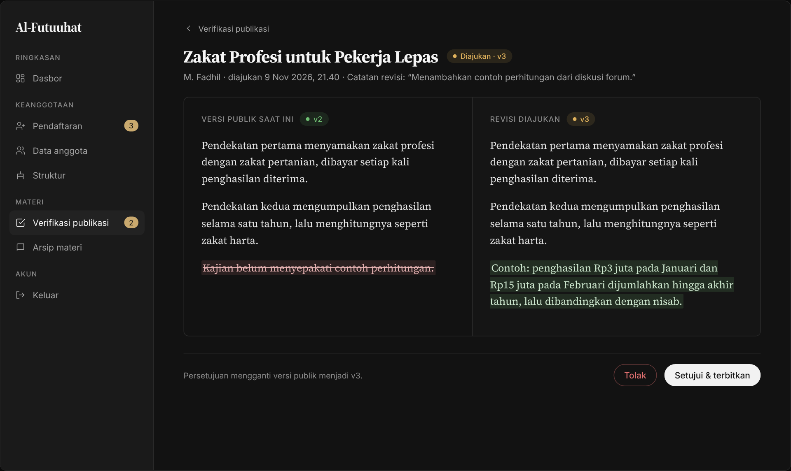
- Dua kolom berdampingan: versi publik | revisi diajukan (KP-11.2); bila belum pernah terbit, cukup satu kolom. Penanda tambah/hapus (hijau/merah) **opsional**, yang wajib hanya dua kolom berdampingan.
- Bilah keputusan menempel di bawah: Tolak (`btn-bahaya`) dan "Setujui & terbitkan" (`btn-primer`).

#### 25 · Dialog tolak (catatan wajib) — `/admin/verifikasi-materi/[revisiId] → Tolak`
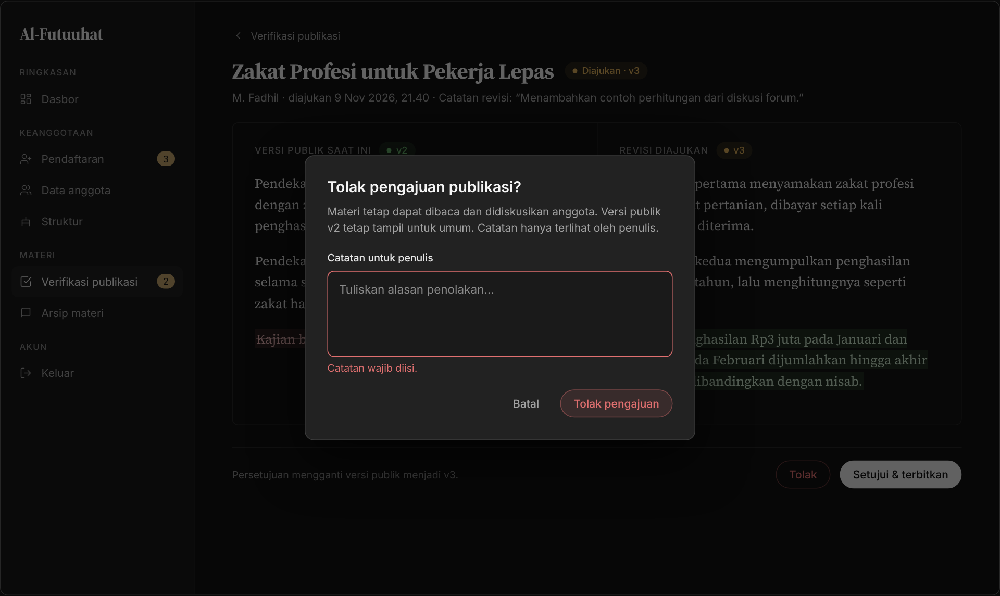
- `ConfirmDialog` dengan isian catatan wajib; tombol Tolak menampilkan galat bila kosong (KP-11.4). Teks menjelaskan akibatnya bagi anggota dan pengunjung.

### 6.4 Lainnya

#### 26 · Keadaan memuat & kosong — `(semua halaman daftar)`
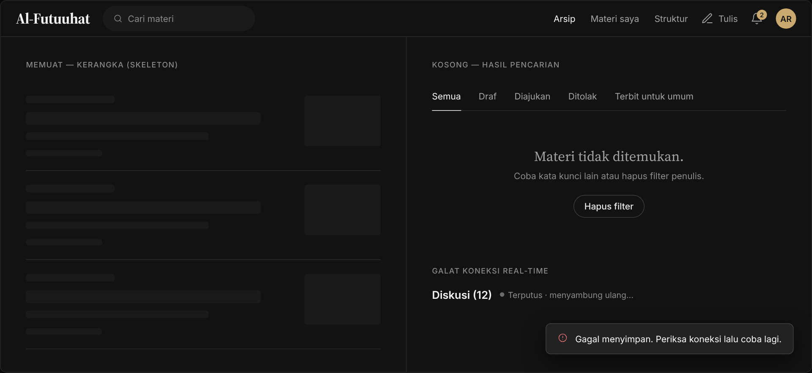
- Memuat: kerangka berbentuk sama dengan `StoryRow`. Kosong: `EmptyState` + satu tombol. Real-time terputus: indikator abu-abu "Terputus · menyambung ulang…". Galat simpan: *toast*.

#### 27 · Halaman tidak ditemukan (404) — `(route tidak ada / materi belum terbit)`
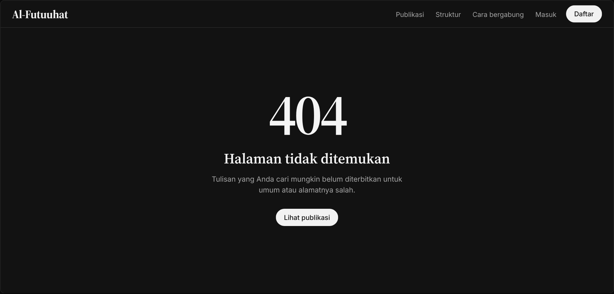
- Dipakai untuk route yang tidak ada dan materi yang belum terbit lewat `/publikasi/[slug]` (KP-17.3). Angka serif besar, satu tombol.

#### 28 · Baca materi di ponsel — `/materi/[slug] (390 px)`
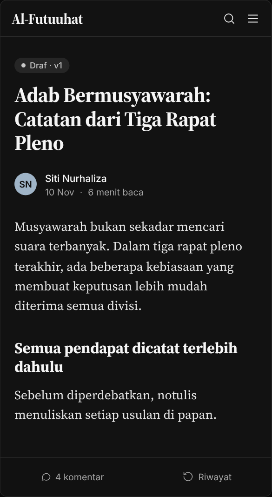
- Header 52 px. Judul 30 px, isi 18 px. `ActionBar` pindah ke bilah bawah yang menempel.

#### 29 · Daftar publikasi di ponsel — `/publikasi (390 px)`
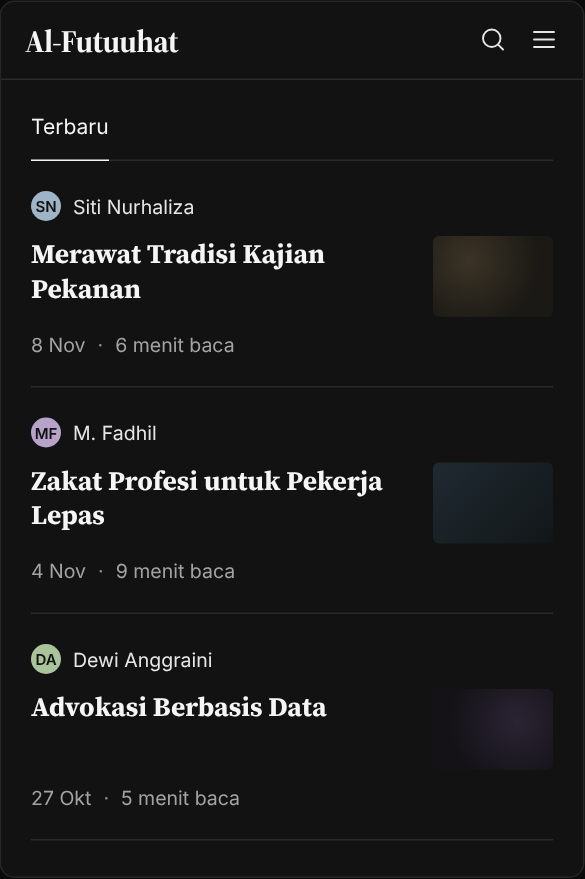
- `StoryRow` versi ponsel: gambar 80×54 px di kanan judul, ringkasan disembunyikan.

#### 30 · Menu laci di ponsel — `(layout anggota, 390 px)`
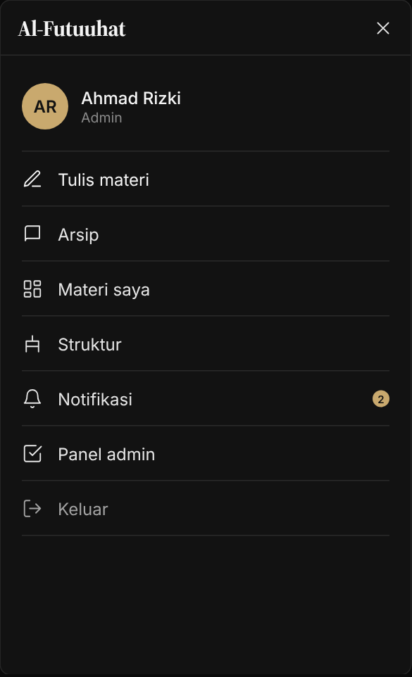
- Menu laci layar penuh: profil, menu utama, notifikasi dengan lencana, "Panel admin" (khusus admin), Keluar.

#### 31 · Bagan struktur di ponsel — `/struktur (390 px)`
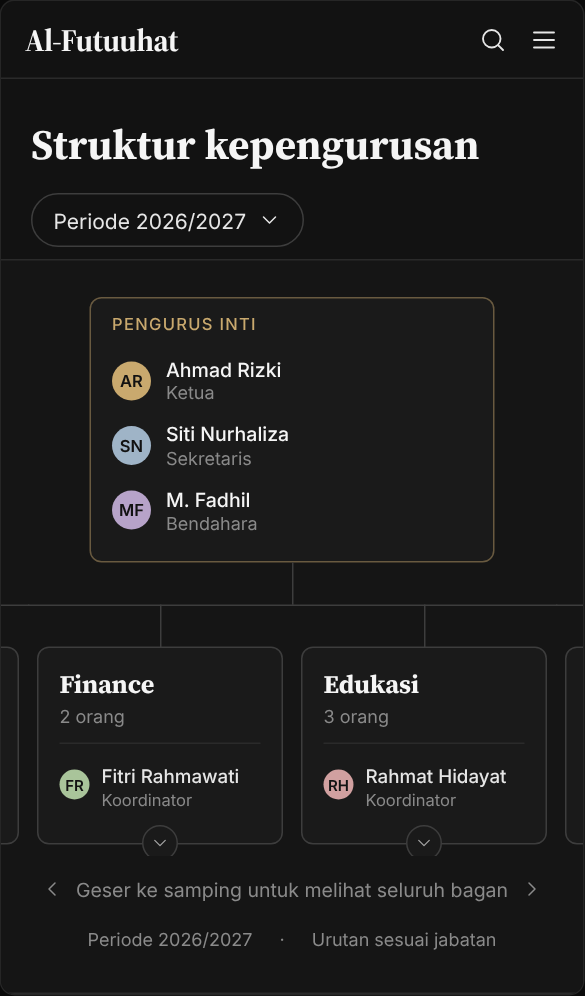
- Bagan tetap utuh dan digulir mendatar; posisi gulir awal di tengah (kotak Pengurus inti). Petunjuk "Geser ke samping untuk melihat seluruh bagan" di bawahnya.

## 7. Status materi → tampilan

| `materi.status` | Label *chip* | Kelas | Tombol utama penulis di editor |
|---|---|---|---|
| `draf` | Draf | `.chip-draf` | "Ajukan publikasi" (`btn-primer`) |
| `diajukan` | Diajukan | `.chip-diajukan` | "Batalkan pengajuan" (`btn-sekunder`); editor hanya-baca dengan pesan "Sedang ditinjau admin. Batalkan pengajuan untuk mengubah." (KP-10.4, 10.6) |
| `ditolak` | Ditolak | `.chip-ditolak` | "Buat revisi" (`btn-primer`) |
| `terbit` | Terbit untuk umum | `.chip-terbit` | "Buat revisi" bila revisi terakhir `disetujui`/`ditolak`; bila ada revisi `draf`/`diajukan`, tombolnya mengikuti status revisi tersebut |

Di area anggota, label lengkap di legenda adalah "Draf — hanya anggota", "Diajukan — menunggu admin", "Ditolak — tetap untuk anggota", dan "Terbit untuk umum".

## 8. Editor Quill

- Pakai tema `snow` (`quill/dist/quill.snow.css`), dibungkus elemen `.prosa-editor`. *Override* gelapnya sudah ada di `main.css`.
- Toolbar yang dipakai: `[{ header: [2, 3, false] }], 'bold', 'italic', 'link', { list: 'ordered' }, { list: 'bullet' }, 'blockquote', 'image'`. Tidak ada warna teks, ukuran huruf, atau font, agar tampilan tetap seragam.
- *Handler* `image` mengunggah ke `POST /unggah-gambar`, lalu menyisipkan URL (KP-08.2). Selama mengunggah, tampilkan *toast* "Mengunggah gambar…".
- HTML yang ditampilkan di halaman baca dibungkus `.prosa`, sehingga tampilan editor dan tampilan baca identik.

## 9. Bagan struktur (PrimeVue OrganizationChart)

Struktur organisasi di beranda, `/struktur`, dan pratinjau admin ditampilkan sebagai **bagan** dengan komponen `OrganizationChart` dari PrimeVue.

### 9.1 Versi dan lisensi

- Pakai **PrimeVue 4.5.5** (tag `v4-stable`, lisensi **MIT**). Kunci versinya tanpa `^` agar `npm install` tidak naik ke v5.
- **PrimeVue 5.x** (rilis terbaru) **tidak lagi MIT**. Versi itu memakai PrimeUI License dan mewajibkan *license key*. Ada Community License gratis untuk individu, mahasiswa, dan organisasi nirlaba, tetapi harus diperbarui setiap tahun, dan tanpa *key* yang valid aplikasi dapat menampilkan pemberitahuan lisensi.
- API v5 juga berbeda dari v4: `value` berupa *array*, memakai `label`, dan tidak ada *slot* per `type`. Seluruh contoh di dokumen ini memakai **API v4**.

### 9.2 Pemasangan (Nuxt)

```bash
npm i primevue@4.5.5 @primeuix/themes@2.0.3
npm i -D @primevue/nuxt-module@4.5.5
```

```ts
// nuxt.config.ts (potongan)
import Aura from '@primeuix/themes/aura'

export default defineNuxtConfig({
  modules: ['@primevue/nuxt-module'],
  primevue: {
    autoImport: false,
    components: { include: ['OrganizationChart'] }, // hanya komponen ini
    options: {
      theme: { preset: Aura, options: { darkModeSelector: '.app-gelap' } }
    }
  },
  app: { head: { htmlAttrs: { lang: 'id', class: 'app-gelap' } } }
})
```

- Warna bagan diatur oleh blok `.p-organizationchart { --p-organizationchart-… }` di `main.css`. Blok ini memetakan token desain PrimeVue ke token Al-Futuuhat. Jangan mengubah warna lewat *preset*.
- Komponen PrimeVue lain **tidak dipakai**. Tombol, formulir, tabel, dan modal tetap memakai komponen sendiri sesuai §5.

### 9.3 Bentuk data bagan

Bagan dibangun di *frontend* dari respons `GET /periode/{periode}/struktur`. Bentuk respons di bawah adalah **asumsi**; sesuaikan dengan *API Resource* yang dibuat di F4.

```ts
// composables/useBaganStruktur.ts
// Asumsi respons: { periode, pengurus_inti: Pengurus[], divisi: { id, nama_divisi, pengurus: Pengurus[] }[] }
// Pengurus = { nama, jabatan } dan sudah diurutkan berdasarkan jabatan.urutan oleh API.
export function useBaganStruktur(struktur: Ref<StrukturPeriode | null>) {
  const nodes = computed(() => {
    if (!struktur.value) return null
    return {
      key: 'inti',
      type: 'inti',
      styleClass: 'bagan-inti',
      data: { pengurus: struktur.value.pengurus_inti },
      children: struktur.value.divisi.map((d) => {
        const [koordinator, ...lainnya] = d.pengurus
        return {
          key: `divisi-${d.id}`,
          type: 'divisi',
          data: { nama: d.nama_divisi, jumlah: d.pengurus.length, koordinator },
          children: lainnya.length
            ? [{ key: `anggota-${d.id}`, type: 'anggota', styleClass: 'bagan-anggota', data: { pengurus: lainnya } }]
            : []
        }
      })
    }
  })

  const collapsedKeys = ref<Record<string, boolean>>({})
  const tutupSemua = () => {
    collapsedKeys.value = Object.fromEntries((nodes.value?.children ?? []).map((n) => [n.key, true]))
  }
  const bukaSemua = () => { collapsedKeys.value = {} }
  watch(nodes, tutupSemua, { immediate: true }) // semua divisi tertutup saat periode berganti

  return { nodes, collapsedKeys, bukaSemua, tutupSemua }
}
```

```vue
<!-- components/BaganStruktur.vue (potongan template) -->
<div class="bagan-wrap">
  <div ref="gulir" class="bagan-scroll">
    <OrganizationChart
      v-if="nodes"
      :value="nodes"
      collapsible
      v-model:collapsedKeys="collapsedKeys"
      :pt="{ nodeToggleButton: { 'aria-label': 'Buka atau tutup anggota divisi' } }"
    >
      <template #inti="{ node }"><!-- label "PENGURUS INTI" + baris avatar/nama/jabatan --></template>
      <template #divisi="{ node }"><!-- nama divisi (serif), "n orang", koordinator --></template>
      <template #anggota="{ node }"><!-- baris avatar/nama/jabatan, dipisah garis --></template>
    </OrganizationChart>
  </div>
</div>
```

### 9.4 Aturan tampilan

| Kotak | Lebar | Isi |
|---|---|---|
| Pengurus inti (akar) | ±270 px | Label kecil `PENGURUS INTI` warna `aksen`, lalu baris avatar 26 px · nama 13 px · jabatan 12 px `text-teks-redup`. Tepi bergaris aksen (`bagan-inti`). |
| Divisi (cabang) | 164 px | Nama divisi serif 17 px tebal, "n orang" 12 px, garis, lalu koordinator (avatar 20 px, nama, jabatan). Tombol buka-tutup bulat 24 px di tepi bawah. |
| Anggota divisi (daun) | 164 px | Latar `angkat` (`bagan-anggota`), baris pengurus lain urut `jabatan.urutan`, dipisah garis. |

- Enam divisi pada satu baris membutuhkan ±1.060 px, sehingga muat di `max-w-halaman`. Karena anggota divisi digabung dalam **satu** kotak, membuka divisi tidak membuat bagan melebar.
- **Ponsel:** bagan tidak diubah menjadi daftar. Bagan digulir mendatar, posisi gulir awal di tengah (`el.scrollLeft = (el.scrollWidth - el.clientWidth) / 2` saat `onMounted`), dengan petunjuk "Geser ke samping untuk melihat seluruh bagan".
- **Avatar:** API publik tidak mengirim `id`, jadi warna avatar di bagan diambil dari *hash* nama (mis. jumlah kode karakter `% 5`).
- **Kosong:** periode tanpa pengurus → `EmptyState` "Belum ada susunan pengurus untuk periode ini." Divisi tanpa pengurus → kotak divisi dengan teks "Belum ada pengurus" dan tanpa tombol buka-tutup.
- Di beranda, bagan tampil tanpa tombol "Buka/Tutup semua". Di `/struktur`, tombol itu tampil di kanan atas bingkai.

## 10. Catatan data tampilan

- **Gambar di `StoryRow`:** tabel `materi` tidak punya kolom sampul. Jika ingin menampilkan gambar, ambil **gambar pertama** dari `konten_html` di *API Resource* (mis. `gambar_pertama`). Jika tidak ada (atau belum ditambahkan ke API), baris tampil tanpa gambar dan kolom teks melebar. Ini tambahan kecil pada *Resource*, bukan perubahan tabel. Putuskan dulu sebelum membangun F6.
- **Menit baca:** `ceil(jumlah kata / 200)` dari teks `konten_html`. Boleh dihitung di *Resource* atau di *frontend*. Jika tidak tersedia di daftar, cukup tampilkan tanggal.
- **Waktu relatif** ("2 jam lalu") untuk komentar; tanggal "9 Nov 2026" untuk materi. Pakai `Intl.DateTimeFormat('id-ID')`.

## 11. Keadaan, teks, aksesibilitas

- **Memuat:** kerangka abu-abu (`bg-permukaan animate-pulse`) dengan bentuk yang sama seperti kontennya. Jangan memakai *spinner* di tengah halaman.
- **Galat:** pesan di bawah isian (`.pesan-galat`) untuk validasi 422; *toast* untuk galat umum; halaman "Halaman tidak ditemukan" serif untuk 404 (termasuk KP-17.3).
- **Teks antarmuka:** bahasa Indonesia, huruf kapital hanya di awal kalimat ("Ajukan publikasi", bukan "Ajukan Publikasi"). Gunakan kata kerja yang jelas dan pendek.
- **Aksesibilitas:** fokus *keyboard* selalu terlihat (garis `aksen`); target sentuh minimal 40×40 px; ikon tanpa teks wajib memakai `aria-label`; status tidak boleh dibedakan dengan warna saja (*chip* selalu memuat teks).
- **Responsif:** uji di lebar 390 px dan 1280 px untuk setiap halaman (KNF-04).

## 12. Boleh dan tidak boleh

**Boleh**
- Memakai token dan kelas dari `main.css`.
- Satu tombol primer per kelompok aksi.
- Garis tipis untuk memisahkan bagian.

**Tidak boleh**
- Menulis hex langsung di komponen, atau memakai warna Tailwind bawaan (`bg-gray-800`, `text-green-500`, dst.).
- Memakai huruf sans untuk isi materi, atau ukuran isi materi di bawah 18 px.
- Memakai aksen untuk latar besar atau tombol primer.
- Menyalin nama, logo, ikon *clap*, atau warna hijau Medium.
- Memakai kartu dengan bayangan besar, gradien mencolok, atau sudut sangat membulat untuk daftar tulisan.
- Menampilkan foto, nomor HP, alamat, atau email anggota di halaman publik.
- Memakai komponen PrimeVue selain `OrganizationChart`, atau memasang PrimeVue 5.x tanpa keputusan soal *license key* (§9.1).

## 13. Sumber acuan

Nilai pada §2 dikumpulkan dari analisis pihak ketiga, **bukan** dokumentasi resmi Medium. Antarsumber ada perbedaan kecil (mis. isi 18–21 px), sehingga dipakai sebagai arah saja.

- webdesignhot — Medium DESIGN.md: <https://www.webdesignhot.com/design.md/medium/> (lebar baca 680 px, bingkai 1192 px, header 57 px, skala tipografi, tombol pil)
- Oppadu — Design Systems Gallery: Medium: <https://www.oppadu.com/tools/design-systems-site/brand/medium.html> (token warna terang/gelap, kartu tulisan, tag, topnav)
- Open Skill Index — design-readability: <https://openskillindex.com/skills/intense-visions-harness-engineering-design-readability> (isi 21 px, *line-height* 1,58, ±680 px)
- Design Your Way — What font does Medium use: <https://www.designyourway.net/blog/what-font-does-medium-use/> (Charter sebagai huruf isi, lisensi versi terbuka)
- Fonts In Use — Medium.com (2017): <https://fontsinuse.com/uses/18899/medium-com-2017> (riwayat pilihan huruf Medium)

Acuan PrimeVue (§9):

- PrimeVue — OrganizationChart: <https://primevue.dev/organizationchart>
- PrimeVue — Nuxt: <https://primevue.dev/nuxt>
- Lisensi primevue@5.0.0 (LICENSE.md): <https://app.unpkg.com/primevue@5.0.0/files/LICENSE.md>
- Registri npm: `primevue` dist-tag `v4-stable` = 4.5.5 (MIT), `latest` = 5.0.4 (diperiksa 10 November 2026)
